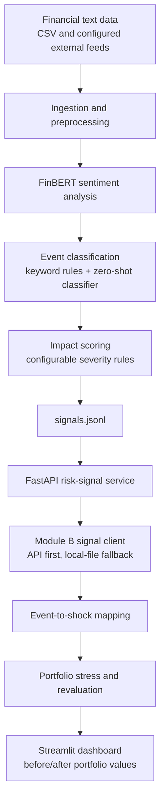

# AI Financial Risk Engine & Portfolio Analytics — S&P Global & Crisil Campus Hackathon

**Candidate Name:** Ayush Parmar  
**College Email ID:** ayushp.mc.24@nitj.ac.in 
**College / Campus:** Dr. B. R. Ambedkar National Institute of Technology (NIT) Jalandhar  
**Demo Video Link:** (https://youtu.be/NPPHKziyzDc)  
**Slide Deck Link (if hosted externally):** presentation.pdf

---

## 1. Project Overview / Problem Statement & Approach

Financial markets react to events reported across news articles and other text-based sources. However, unstructured information is difficult to consume directly in a risk-management workflow. Analysts need a way to turn text into structured, interpretable signals and assess how significant events could affect financial exposures.

This project implements an **AI/NLP Risk Engine** that processes financial text and produces structured risk signals containing sentiment, event classification, and an impact score. The pipeline uses **FinBERT** for financial sentiment analysis, a combination of keyword rules and zero-shot classification for event categorization, and a configurable rule-based method for estimating event severity. The resulting signals are written to JSONL files and exposed through a **FastAPI** service.

The downstream application is **Module B: Strategic Portfolio Stress Testing**. It consumes the risk signals and maps qualifying events to simplified market and credit shocks. A synthetic portfolio containing asset classes such as loans, bonds, equities, and derivatives is revalued under the selected scenario, and a **Streamlit dashboard** presents the portfolio before and after the stress test. The stress-testing calculations and shock values are conceptual assumptions for the hackathon; they are not predictions or guarantees of actual market losses.

## 2. Architecture & Tech Stack

### Architecture and data flow



### Risk Engine pipeline

The pipeline runs the processing stages in sequence:

| Stage | Purpose | Output |
|---|---|---|
| Ingestion | Load financial text into a consistent record format | `data/articles.jsonl` |
| Sentiment analysis | Estimate positive, negative, and neutral sentiment with FinBERT | `data/scored.jsonl` |
| Event classification | Assign an event category using keyword rules and zero-shot classification | `data/classified.jsonl` |
| Impact scoring | Calculate a severity score on a 1–10 scale | `data/signals.jsonl` |

The pipeline supports full runs and selective reruns. For example, after adjusting event rules, the event and impact stages can be rerun without repeating every earlier stage.

### Technology stack

- **Python** — pipeline and application logic
- **Hugging Face Transformers** — pretrained NLP models
- **ProsusAI/finbert** — financial sentiment classification
- **facebook/bart-large-mnli** — zero-shot event classification
- **spaCy** — text processing and named-entity extraction, where configured
- **FastAPI** — HTTP API for risk signals
- **Uvicorn** — ASGI server for FastAPI
- **Streamlit** — Module B dashboard
- **Pandas / NumPy** — data processing and numerical calculations
- **JSONL** — intermediate and final structured records

## 3. Dataset Used

The system is designed to process financial-news text from a local CSV dataset and configured external ingestion sources. The pipeline normalizes records into a common representation containing fields such as an identifier, timestamp, source, headline, and body. GDELT ingestion is supported by the pipeline configuration; it can be skipped when rate-limited.

Module B uses sample transaction data to construct a **synthetic wholesale-banking portfolio**. The portfolio is used for scenario analysis and should not be interpreted as real customer or bank exposure.

**Dataset notes and assumptions:**

- The exact public name and URL of the original financial-news dataset should be added here if the dataset is publicly sourced.
- The exact source of each input record depends on the configured ingestion path and the data available locally.
- Impact scores are generated by a transparent, configurable heuristic because a validated labeled dataset for market-impact severity is not assumed.
- Stress shocks and portfolio valuation relationships are simplified modeling assumptions for demonstration.
- The project should not be interpreted as investment advice or a production-grade risk model.

## 4. Quickstart & Installation

**Runtime:** Python 3.13.6 (reported development environment; compatibility may depend on the installed versions of the NLP libraries and their dependencies)  
**OS tested:** Windows 11

### Prerequisites

- Python installed and available from the terminal
- Git
- Internet access on first run if pretrained Hugging Face models need to be downloaded
- The repository's required input data and dependency file

### Clone the repository

Replace the URL below with the public repository URL before publishing this README.

```bash
git clone https://github.com/ayush-p-14k-18k/nitjalandhar_ayushparmar_code2connect.git
cd code
```

### Create and activate a virtual environment

**Windows PowerShell:**

```powershell
python -m venv .venv
.\.venv\Scripts\Activate.ps1
```

**macOS / Linux:**

```bash
python3 -m venv .venv
source .venv/bin/activate
```

### Install dependencies

Run this from the directory containing the relevant `requirements.txt`:

```bash
pip install -r requirements.txt
```

If the repository keeps the application code under a `code/` directory, first run `cd code`. Run the following commands from the directories containing the corresponding scripts.

### Run the Risk Engine pipeline

```bash
python pipeline.py
```

Useful pipeline options:

```bash
python pipeline.py --no-gdelt       # Run the pipeline without GDELT ingestion
python pipeline.py --from events   # Rerun event classification and impact scoring
python pipeline.py --only impact   # Rerun only impact scoring
python pipeline.py --dry-run       # Preview the stages that would run
```

The full pipeline writes intermediate data to JSONL files and produces `data/signals.jsonl` for downstream consumption. The sentiment stage may take several minutes on CPU. Run the pipeline before the demo if model inference would otherwise delay the walkthrough.

### Start the API

From the directory containing `api.py`:

```bash
uvicorn api:app --reload
```

Open the interactive API documentation at:

`http://127.0.0.1:8000/docs`

Available endpoints:

| Endpoint | Purpose |
|---|---|
| `GET /health` | Check service and data status |
| `GET /signals` | Filter, sort, and paginate risk signals |
| `GET /signals/latest` | Retrieve the newest timestamped signals |
| `GET /signals/{id}` | Retrieve one signal by ID |
| `GET /stats` | View signal counts and mean impact by event type |

Example queries:

```text
http://127.0.0.1:8000/signals?min_impact=7
http://127.0.0.1:8000/signals?event_type=Geopolitical&live_only=true&sort=time
http://127.0.0.1:8000/signals/latest?limit=10
```

The API reloads the signals data when `data/signals.jsonl` changes, so rerunning the pipeline can update the served data without manually restarting the service.

### Start Module B: Strategic Portfolio Stress Testing

From the directory containing the Streamlit `app.py`:

```bash
streamlit run app.py
```

Streamlit will print a local URL in the terminal, typically:

`http://localhost:8501`

The dashboard uses the risk-signal client to read signals from the API first and the local signals file as a fallback. It maps qualifying event signals to configured shocks, revalues the portfolio, and displays the scenario's before/after results.

> **Directory note:** Commands above assume each command is run from the directory containing the named script. If your repository places the Risk Engine and Module B in separate subdirectories, change to the appropriate directory before running each command.

## 5. Key Results & Domain Impact

### What the prototype demonstrates

- **Text-to-signal pipeline:** Converts financial text into structured records suitable for downstream applications.
- **Financial sentiment:** Produces a sentiment score between `-1` and `+1` from FinBERT's positive and negative class probabilities.
- **Event classification:** Categorizes events such as Geopolitical, Macroeconomic, Credit Event, Merger/Acquisition (M&A), and Product Launch using keyword rules and zero-shot classification.
- **Impact scoring:** Produces a configurable severity score on a `1–10` scale.
- **API integration:** Makes risk signals available to downstream consumers through FastAPI and JSONL output.
- **Event-driven stress testing:** Applies configured shocks to a synthetic portfolio when signals meet the module's trigger rules.
- **Portfolio valuation comparison:** Visualizes pre-stress and post-stress values and the resulting modeled impact.

### Stress-testing methodology

The stress-testing module maps event categories and impact scores to configured market and credit shocks. Base shocks are calibrated for an impact score of 7 and scaled using:

```text
severity = clip(impact_score / 7, 0.5, 1.5)
```

The resulting shocks are used in simplified asset revaluation calculations. Examples include:

- **Bonds:** Interest-rate and spread changes modeled using duration, spread duration, and convexity terms.
- **Loans:** Changes in expected credit losses and a simplified spread-related valuation effect.
- **Equities:** Market movement, beta, sector add-ons, and oil sensitivity.
- **Derivatives:** Interest-rate swap and oil-futures valuation changes under the selected scenario.

The shock table and formulas are configurable assumptions. They are intended to demonstrate an event-to-portfolio workflow rather than provide validated forecasts of market behavior.

### Domain impact

The platform illustrates how financial text can be converted into a consistent risk representation and connected to portfolio-level scenario analysis. This can help analysts explore which events merit further investigation, understand the modeled sensitivity of different asset classes, and communicate scenario impacts through a dashboard.

**Evaluation note:** No model-accuracy, latency, or financial-loss-prediction metrics are claimed in this README because validated measurements have not been provided. Add measured results and screenshots here when available.

---

## Repository and submission links

- **Source code:** https://github.com/ayush-p-14k-18k/nitjalandhar_ayushparmar_code2connect.git
- **Demo video:** (https://youtu.be/NPPHKziyzDc)

## Disclaimer

This project is a hackathon prototype for educational and demonstration purposes. Sentiment, event classifications, impact scores, and stress-test results are subject to model limitations, data quality, and configured assumptions. Outputs are not investment advice, verified forecasts, or a substitute for professional financial risk assessment.
